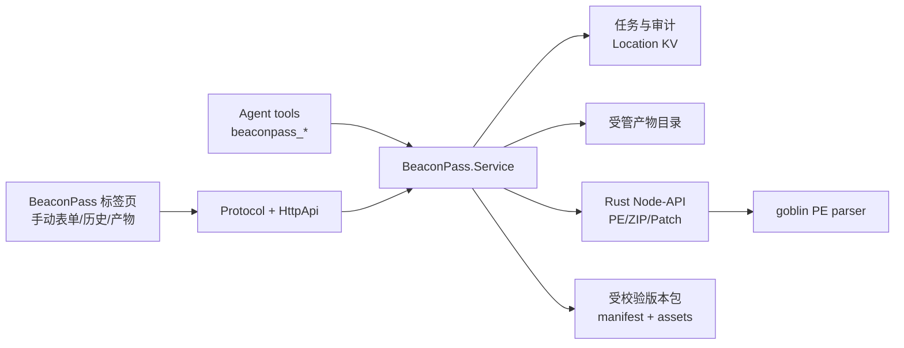

# BeaconPass 原生集成技术路线

日期：2026-10-15。状态：首个可交付纵向切片已完成，公共 Protocol/HttpApi 与客户端代码已经生成。

## 实施状态

当前已完成 PE 检查与 PE→Shellcode 的端到端接入：纯 Rust Node-API 原生模块、四套内置 x86/x64 scheme stub、Location 领域服务、任务与产物记录、公共 API、生成客户端、Agent tools、提示词、BeaconPass 标签页、中英文文案以及六目标桌面构建链。人工操作与模型工具共用同一个服务、事件和产物记录。

当前 slice 明确只覆盖原生 x86/x64 PE。解释器版本包、声明式 PatchRecipe、流式上传/下载、任务取消与内容寻址产物生命周期仍是后续阶段；这些能力不能在缺少受校验资产、迁移 fixture 和兼容性基线时伪装成已实现。

## 决策

BeaconPass 作为 Amon 的内建领域能力实现，不把现有 Flask 服务、PostgreSQL、OSS 或 Python 进程一起搬入桌面端。手动界面和 Agent tools 必须调用同一个 Location 作用域的 `BeaconPass.Service`，共享任务、产物、审计和错误模型，避免出现一套 UI 逻辑和一套 Agent 逻辑。

原生计算层使用 Rust，并通过稳定的 Node-API 加载到 `amon-engine` 进程。Bun 官方把 Node-API 作为生产可用的原生扩展方式，并明确把 `bun:ffi` 标为实验能力，因此不采用 FFI。Rust 层负责 PE 解析/重建、归档修改、校验和及大文件流式处理；TypeScript/Effect 层负责权限、任务编排、持久化、HTTP 与工具注册。

PE 转换第一阶段按 BeaconPass 当前算法做等价迁移，使用纯 Rust `goblin` 解析 PE，并以边界检查后的手工重排保留现有 scheme/stub 语义。这样避免 LIEF Rust 构建阶段下载平台预编译二进制，也让 Windows、Linux、macOS 的 x64/ARM64 CI 只依赖标准 Rust toolchain。Donut 可以作为以后可选的第二转换后端，但不能替换第一阶段：它会产生不同的加载器和兼容行为，无法作为现有产物的无损替代。

Python loader 第一阶段不在 Amon 运行时编译 `.py`。现有平台只动态改写固定的 `encodings/__init__.py` 与固定 loader 模板，并未提供任意用户源码编译；因此将每个受支持 CPython 小版本的两个固定模块预编译成受校验的版本包，loader 从版本包内的独立 payload 数据项读取输入。Amon 生成时只选择版本包、写入 payload、修改 ZIP 和输出产物。这条路线没有 Python 子进程，也不会把多个 Python 编译器装进 Amon。

如果以后明确增加“任意 Python 源码编译为指定 CPython 版本 `.pyc`”，必须另立能力。CPython bytecode、magic number、marshal code object 和 ABI 都随小版本变化；RustPython 等实现生成的不是 CPython 兼容 `.pyc`。稳定 ABI 只能让宿主调用不同 CPython，不能让一个编译器生成所有版本的 bytecode。届时只有两条可靠路线：限制到 Amon 明确支持的一个 CPython 小版本，或提供按版本安装的 CPython compiler pack。后者仍然是在维护多个版本，只是可以进程内嵌入，不能假装这个约束消失。

## 现有 BeaconPass 实现审计

当前 `E:\BeaconPass-CentralPlatform-Dev` 工作树有大量未提交重构，分析过程中保持只读。当前能力如下：

| 能力 | 当前实现 | Amon 迁移结论 |
| --- | --- | --- |
| EXE 转 Shellcode | `utils/pe_converter.py` 用 LIEF 解析 PE，校验重定位/.NET，执行 Raw→Virtual 重排，保留 overlay，重写节表和数据目录，再拼接 x86/x64 stub；路由支持 bin/hex/C 格式、历史和下载 | 首个原生后端，Rust/LIEF 等价移植；格式化留在 TypeScript，二进制算法留在 Rust |
| 解释器 loader | Perl/Ruby 修改模板和压缩包；Python 下载/读取 embeddable ZIP，改写 `encodings/__init__.py`，调用目标版本 `python -m py_compile`，插入 loader `.pyc` 后裁剪归档 | Perl/Ruby 用内建归档转换；Python 改成预编译版本包 + 独立 payload 数据，不在运行时启动解释器 |
| PATCH 产物 | 白文件、方案、偏移/入口/模板、单文件或分离产物、IOC 更新、历史记录 | 第二阶段迁移为声明式 `PatchRecipe` 和原生二进制 patch engine；先冻结现有输入/输出语义，不把旧数据库模型照搬 |
| AI Agent | Flask 内有任务、事件、SSE、LLM 配置、IDA MCP 分析流程 | 不迁移第二套 Agent。改为 Amon 原生工具和现有 Session 执行；长任务通过 BeaconPass job/event 投影展示 |
| IDA | 仓库中包含 IDA/idalib 及 MCP 代码，服务串行分析 | Amon 已有 MCP 能力；只做可选外部 IDA MCP 连接，不把 IDA 程序、许可或 Python 环境打进 Amon |
| 平台设施 | Flask、JWT、角色、API Key、PostgreSQL、OSS、Docker、管理后台 | 桌面本地能力不需要这些设施；复用 Amon 权限、SQLite、文件系统、Protocol、Client 和 GUI extension |

## 目标结构



建议目录：

```text
packages/amon-native/
  Cargo.toml
  src/pe.rs
  src/archive.rs
  src/patch.rs
  src/napi.rs
packages/schema/src/beaconpass.ts
packages/core/src/beaconpass.ts
packages/core/src/beaconpass/
  service.ts
  store.ts
  artifact.ts
  package.ts
packages/core/src/tool/plugin/beaconpass.ts
packages/protocol/src/groups/beaconpass.ts
packages/server/src/handlers/beaconpass.ts
packages/gui-extensions/src/beaconpass/
  index.ts
  renderer.tsx
  workspace.tsx
  contract.ts
  i18n/en.ts
  i18n/zh.ts
```

依赖方向保持 `Schema -> Core/Protocol -> Server`。Client 只依赖 Schema/Protocol；GUI extension 只通过生成 Client 和 SDK 访问，不导入 Core/Server。公共 HttpApi 落地后必须从 `packages/client` 运行 `bun run generate`，生成文件不手改。

## 原生计算层

### PE 后端

使用固定版本的纯 Rust `goblin` 解析 PE，转换器只在一次验证后的布局对象上操作原始字节。四套 BeaconPass x86/x64、scheme 1/2 stub 使用 `include_bytes!` 编译进原生模块；用户仍可显式提供自定义 stub 覆盖内置资源。

Node-API 只暴露窄接口：

- `inspectPe(bytes)`：架构、入口点、重定位、TLS、CLR、节和 overlay 摘要。
- `convertPe(input)`：输入 PE、受信任 stub 和 scheme，返回二进制及结构化诊断。
- `applyPatchRecipe(input)`：按已验证 recipe 修改白文件，返回产物和修改回执。
- `rewriteArchive(input)`：按 manifest 替换/添加 ZIP 项，保持确定性时间戳和顺序。

每个入口对长度、偏移、加法溢出、节区范围和输出上限做一次边界校验。CPU 工作通过 Node-API async task 在线程池执行，不能阻塞 Amon Session 执行循环。Rust panic 转换为有类型错误，禁止跨 FFI unwind。

不把“所有格式都支持”作为第一阶段目标。首版仅承诺现有 BeaconPass 的 PE32/PE32+、x86/x64、具有重定位表的 native PE；.NET、缺失重定位、ARM64 PE、损坏节表和超限文件给出明确的 unsupported/invalid 结果。

### Donut 的定位

Donut 是成熟的 position-independent shellcode 生成器，支持 native PE、.NET 和脚本，提供 Linux/Windows 静态与动态库，BSD-3-Clause。它适合作为后续 `engine: "donut"`，用于用户明确选择的兼容模式。首版不打开 AMSI/WLDP/ETW patch 等可选行为，不让它改变现有 scheme 的结果，也不让它成为隐式 fallback。

### Python 版本包

一个版本包只描述目标产物，不是 Amon 的运行时解释器：

```text
python-3.7.9-windows-amd64/
  manifest.json
  licenses/
  runtime.zip
  modules/encodings-init.pyc
  modules/loader-thread.pyc
  modules/loader-direct.pyc
```

`manifest.json` 至少记录包格式版本、CPython 完整版本和 magic、目标 OS/arch、loader API 版本、每个文件 SHA-256、来源和许可。版本包在受控构建任务中一次性生成并用 fixture 验证，发布为独立可选资源；Amon 根据 manifest 下载/缓存并校验，离线用户可手动导入。Amon 主安装包不随每次功能升级重复携带所有版本。

生成阶段将 payload 作为独立 ZIP 数据项写入，预编译 loader 通过其 `zipimporter` 的 `get_data()` 读取该固定项。因此 payload 变化不会要求重新生成 code object，也不需要把 `zipfile` 模块留在裁剪后的标准库中。现有两个 Python loader 模板只有 `buf` 字节常量随请求变化，这使该改造边界清楚。若这个布局不能保持当前 Python 3.5/3.6/3.7 点击启动行为，验证阶段立即终止该路线；回退方案是只支持一个明确版本的嵌入式 CPython compiler pack，而不是恢复不受控的系统 Python 查找。

旧版本 CPython 资产不从现代 `python-build-standalone` 假设获得。该项目当前支持 Python 3.10-3.15，可用于未来受支持版本，但现有 3.5-3.7 包需要使用已验证的现有资产或可复现的专用构建，并携带来源、哈希和许可。

## 领域服务、存储与产物

`BeaconPass.Service` 为 Location 作用域。手动请求的 source 为 `manual`；Agent 请求记录 `sessionID`、`messageID` 和 tool call ID。任务属于 Location，可选关联 Session，而不是像战情数据那样强制归属于单个会话。这样用户能在 BeaconPass 标签页查看本工作区全部历史，同时从当前会话筛选 Agent 产物。

当前使用 Location KV 保存最近 500 个 job 与 artifact 元数据，大文件放在 Amon 数据目录的 `beaconpass/<project>/artifacts`。每个产物记录 SHA-256、大小、媒体类型和来源；下一阶段引入取消、幂等和垃圾回收时再升级为完整 job/event 投影与内容寻址布局。

任务状态固定为 `queued/running/succeeded/failed/cancelled`。事件只记录不可派生的新事实；进度、当前步骤和最终结果由事件折叠。一个转换请求带 idempotency key，重复调用返回现有 job，避免模型或 UI 重试产生多份大产物。

版本包、stub 和 recipe 是受信任输入，普通用户上传文件不能冒充它们。管理动作与转换动作分开；配置导入先验证 manifest/schema/hash，再进入可用目录。

## Agent tools

工具命名空间为 `beaconpass`，首批保持小而完整：

- `inspect_pe`：读取 PE 元数据和兼容性诊断，不生成产物。
- `convert_pe`：把工作区内的 EXE 转换成 binary/hex/C 产物，自动选择内置 stub，并返回 artifact ID、路径、SHA-256、大小和诊断。
- `build_interpreter_package`：从已有 artifact 或工作区 `.bin` 生成指定解释器版本包产物。
- `list_capabilities`：列出当前平台可用 native backend、版本包和方案，模型不得猜测版本。
- `get_job`：按 job ID 获取一次状态或结果；不鼓励模型轮询。

PATCH recipe 与自动分析在第二阶段加入独立工具，不能把一个参数巨大的“万能生成”工具一次暴露给模型。

每个产生或修改文件的 tool 叶子先调用 Location 的 `Permission.Service`，显示输入、转换方式和输出目录；读取工作区外路径也需权限。执行结果只给模型结构化摘要和 artifact 引用，不把 shellcode/二进制正文塞入上下文。用户拒绝、纠正和取消沿用 Amon 现有 tool failure 语义。

工具调用和手动按钮最后都进入相同的 `Service.submit(...)`，不得从工具内部调用 HTTP，也不得从 UI 复制转换算法。

## BeaconPass 标签页

新增 `packages/gui-extensions/src/beaconpass` 内建扩展，标签标题为 `BeaconPass`。入口放在会话 side panel 的标签条和 `+` 菜单；复杂工作区使用 `wide: true`，窄屏注册 mobile menu。renderer setup 保持轻量，工作区组件 `lazy()` 加载。

当前内部视图：

1. `转换`：文件路径、PE 检查、scheme、输出格式、可选自定义 stub 与提交。
2. `任务`：手动与 Agent 任务统一列表，状态、来源、错误、产物哈希，以及在文件管理器中显示产物。

解释器包、独立产物管理与版本包配置在其后续能力落地时增加，不提前放置无功能入口。

所有可见文案走扩展 i18n，先提供完整英文源词条和简体中文。长任务使用 server event 更新，断线后用 job ID 恢复；切换会话不取消 Location 任务。删除任务和删除产物分开，仍被任务引用的 artifact 不直接删除。

## Protocol 与文件传输

当前公共 API 保持窄边界：

- `GET /api/beaconpass`：能力、任务与产物快照。
- `POST /api/beaconpass/inspect`：检查 workspace 或已授权本地路径的 PE。
- `POST /api/beaconpass/convert`：执行转换并返回 job 与 artifact。

桌面、本地 Web 和远程 Server 使用同一 API。首版上传设置明确大小上限并流式落盘，不把几十 MB 文件完整保存在 renderer 或 JSON。以后可以为同机桌面增加已授权 path token 优化，但它只能优化传输，不能成为唯一入口。

## 跨平台构建

CI 继续覆盖现有六个桌面目标：Windows x64/ARM64、Linux x64/ARM64、macOS Intel/Apple Silicon。每个 target 构建对应 `.node`，随 `amon-engine` 资源复制，启动时校验 target triple 和 native module version。不能在 x64 runner 上把 host addon 误装进 ARM64 包。

验证分三层：

- Rust：解析/重建单元测试、边界/fuzz corpus、ZIP 确定性和 recipe 范围检查。
- Core：真实 SQLite、权限、取消、幂等、重启恢复和 artifact 生命周期。
- 打包：六目标检查 native addon 存在且架构正确；可原生运行的 runner 执行 fixture 转换。Windows ARM64 若仍使用 x64 runner，只做 PE machine/header 静态检查，并在真实 ARM64 设备补一次发布门禁。

PE parity 使用合法的最小 x86/x64 fixture、含 overlay/TLS/重定位的 fixture 和损坏输入。对现有 Python 实现记录结构化结果与输出哈希作为迁移基线；允许因确定性修复产生一次有说明的 golden 更新，不能只检查“有输出文件”。Python 版本包在目标解释器上实际 import 固定模块并验证 payload 数据读取，不能仅检查 ZIP 文件名。

## 实施顺序

1. 已完成：审计现有 BeaconPass，冻结 EXE 转换限制，不复制 Flask 数据库和云设施。
2. 已完成：建立 Rust Node-API 包，接入六目标 CI 和桌面资源打包。
3. 已完成：移植现有 PE scheme 与四套 stub，并用真实 PE 做结构化转换冒烟。
4. 已完成：增加 Schema/Protocol/Server/Client、Location job/artifact store 与 `beaconpass` 工具命名空间，运行客户端生成器。
5. 已完成：增加 BeaconPass GUI extension，手动操作与工具共享任务和产物。
6. 建立 Python 3.5/3.6/3.7 预编译版本包 spike，先验证独立 payload 布局。验证通过才接入 UI；失败则明确缩减到一个 compiler pack 版本。
7. 第二阶段迁移声明式 PatchRecipe；IDA 分析只通过可选 MCP，为 recipe 生成提供建议，不让模型直接绕过 recipe 校验写任意偏移。

## 采用依据

- [LIEF PE 文档](https://lief.re/doc/latest/formats/pe/index.html)：跨平台 PE 解析、修改和重建，提供 C++/Python/Rust API。
- [LIEF Rust 文档](https://lief.re/doc/stable/rust/lief/pe/struct.Binary.html)：Rust 端可写回文件或直接重建为 bytes。
- [LIEF 项目与许可](https://github.com/lief-project/LIEF)：Apache-2.0，当前 Rust 包与平台构建资料。
- [Bun Node-API 文档](https://bun.sh/docs/runtime/node-api)：Bun 直接加载 `.node` 原生模块。
- [Bun FFI 文档](https://bun.sh/docs/runtime/ffi)：官方明确标为实验能力，并推荐 Node-API 用于生产。
- [Node-API 文档](https://nodejs.org/api/n-api.html)：运行时无关且 ABI 稳定的原生扩展边界。
- [Donut](https://github.com/TheWover/donut)：成熟的 PE/.NET shellcode 生成器及可集成库，BSD-3-Clause。
- [CPython `py_compile`](https://docs.python.org/3/library/py_compile.html) 与 [importlib bytecode 限制](https://docs.python.org/3/library/importlib.html)：`.pyc` 由对应解释器生成，bytecode 格式随 Python 版本变化。
- [PEP 552](https://peps.python.org/pep-0552/)：`.pyc` header、magic 与确定性 hash 模式。
- [CPython `zipimport`](https://docs.python.org/3/library/zipimport.html)：ZIP 内模块的 loader 可读取同一归档中的任意数据项，旧版 Python 3.5 也提供 `get_data()`。
- [CPython C API/ABI 稳定性](https://docs.python.org/3/c-api/stable.html)：同一小版本 ABI 可兼容补丁版本，不同小版本仍需分别处理；稳定 ABI 不等于 bytecode 兼容。
- [Python Build Standalone](https://github.com/astral-sh/python-build-standalone)：现代 CPython 3.10-3.15 的跨平台可分发构建，可作为未来 compiler pack 的来源，而非现有 3.5-3.7 的替代品。
